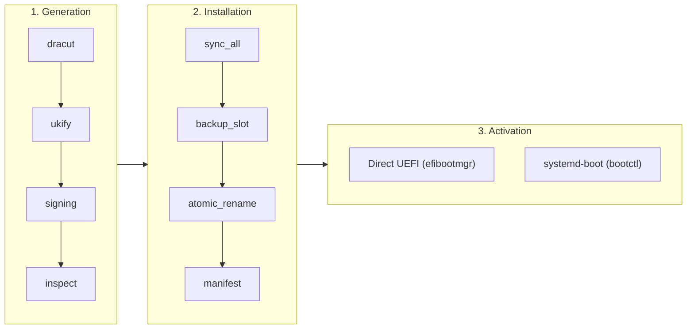

<div align="center">

# RustyUKI

**A reliable, distribution-independent Unified Kernel Image lifecycle manager for Linux.**

[](./LICENSE)
[](https://www.rust-lang.org/)
[](https://fedoraproject.org/)
[]()
[]()

</div>

---

> [!CAUTION]
> **RustyUKI modifies your EFI System Partition and boot entries. A misconfigured build or invalid NVRAM write can impact system availability.**
>
> - Always preview operations with `--dry-run` before applying changes.
> - Ensure you have access to a working Live USB or alternate bootloader. See [Backups & Emergency Recovery](./docs/recovery.md).
> - RustyUKI automatically preserves `.prev.efi` fallback slots and arms one-shot trial boots (`BootNext` / `set-oneshot`) to prevent locking machines out.

---

## Table of Contents

- [What is RustyUKI?](#what-is-rustyuki)
- [Architectural Design](#architectural-design)
- [Key Features](#key-features)
- [Documentation](#documentation)
- [Requirements](#requirements)
- [Installation](#installation)
- [Configuration](#configuration)
- [Command Reference](#command-reference)
- [Safe First Boot Workflow](#safe-first-boot-workflow)
- [Backups & Recovery](#backups--recovery)
- [Contributing & Testing](#contributing--testing)
- [License](#license)

---

## What is RustyUKI?

RustyUKI builds, verifies, installs, and manages the lifecycle of [Unified Kernel Images (UKIs)](https://uapi-group.org/specifications/specs/unified_kernel_image/).

A UKI combines:
1. **Linux kernel** (`vmlinuz`)
2. **Initramfs** (`dracut`)
3. **Kernel command line** (`cmdline`)
4. **Distribution metadata** (`os-release`)
5. **Optional boot splash logo**

Because UEFI firmware can directly execute PE/COFF binaries, a UKI allows firmware to boot Linux directly without intermediate bootloaders, simplifying the boot chain and providing a unified boundary for Secure Boot signing.

> [!NOTE]
> Eliminating intermediate bootloader stages simplifies the boot chain, but overall boot duration is dominated by firmware initialization, kernel hardware discovery, initramfs execution, and userspace startup. Performance benefits should be measured rather than assumed.

---

## Architectural Design

Unlike early prototype scripts that combine compilation, partition writing, and NVRAM modifications into one fragile step, RustyUKI enforces a strict **three-stage decoupled architecture**:



1. **Stage 1: UKI Generation (Isolated Staging)**
   Compiles initramfs (`dracut`), assembles the PE binary (`ukify`), optionally signs for Secure Boot (`pesign`/`sbsign`), and inspects DOS/PE magic headers and hashes. Everything occurs inside an isolated staging directory without touching ESP or firmware variables.
2. **Stage 2: UKI Installation (ESP Storage & Durability)**
   Validates >=50MB free ESP capacity, performs durable writes with explicit `sync_all()`, archives existing UKIs to `.prev.efi` fallback slots, executes atomic renames, and writes sidecar provenance manifests (`.manifest.json`).
3. **Stage 3: Boot Activation (Pluggable Backends)**
   Manages bootloader entries via **Direct UEFI** (`efibootmgr`) or **systemd-boot** (`bootctl`). Supports safe one-shot trial booting (`BootNext` or `set-oneshot`).

---

## Key Features

- **Dual Boot Backends**:
  - **systemd-boot** (default): Standardized Type #2 UKI discovery under `/EFI/Linux/`, `bootctl update`, multi-kernel selection, and `systemd-bless-boot` boot counting without per-kernel NVRAM entries.
  - **Direct UEFI** (first-class): Firmware executes UKIs directly. Manages NVRAM entries, avoids duplicates, arms `BootNext` trial booting, and provides firmware NVRAM diagnostics.
- **Multi-Stage Health Assessment**:
  Prevents premature boot confirmation. `rustyuki confirm` verifies that userspace reached target operational status via `systemctl is-system-running`. Refuses confirmation if in `emergency`, `rescue`, or `maintenance` mode.
- **Fallback Slots (`.prev.efi`) & Rollback**:
  Existing working UKIs are automatically retained in backup slots. Run `sudo rustyuki rollback` to instantly restore a previous kernel.
- **Provenance Tracking & Foreign UKI Protection**:
  Inspects sidecar manifests (`.manifest.json`) before deleting any files. Never touches foreign or unmanaged UKIs.
- **Kernel Flavor Support**:
  Supports Fedora stock kernels (`kernel-core`), CachyOS high-performance kernels (`kernel-cachyos-lto`), and generic RPM packages.
- **Offline Image Building (`--sysroot`)**:
  Builds UKIs into disk images or sysroots without leaking into host `/proc`, `/sys`, or host UEFI NVRAM.
- **Accurate Command-Line Preservation**:
  Strips only `BOOT_IMAGE=` and `initrd=`, strictly preserving user driver blacklists (`rd.driver.blacklist=*`) and complex storage layers (LUKS, LVM, btrfs subvolumes).
- **Failure Registry in `kernel-install`**:
  Records failed builds persistently under `/var/lib/uki-build/pending-failures/` without breaking package manager transactions.

---

## Documentation

Full in-depth documentation is available in the [`docs/`](./docs/) directory:

| Guide | Description |
|---|---|
| [**Fedora Migration Guide**](./docs/fedora-migration.md) | Step-by-step instructions for existing Fedora installs: Live USB ESP expansion, cmdline setup, and safe trial booting. |
| [**Architecture & Pipeline**](./docs/architecture.md) | Three-stage decoupled pipeline, FAT32 durability, and dual boot backends. |
| [**CLI Reference**](./docs/cli.md) | Exhaustive reference for all subcommands, options, and exit codes. |
| [**Configuration Guide**](./docs/configuration.md) | `/etc/rustyuki/config.toml` schema, Secure Boot signing, and backend selection. |
| [**Boot Safety & Trial Workflow**](./docs/boot-flow-and-safety.md) | Fail-safe trial boot flow (`BootNext`), late-userspace health assessment, and fallback slots. |
| [**Automated Kernel Hook**](./docs/kernel-hook.md) | Hands-off `kernel-install` plugin integration (`90-rustyuki.install`) with failure registry. |
| [**Backups & Emergency Recovery**](./docs/recovery.md) | Instant rollback commands, pre-flight backups, diagnostic matrix, and Live USB runbooks. |
| [**Packaging & CI/CD**](./docs/packaging-and-ci.md) | RPM spec packaging targeting Fedora 44 and Fedora 45, containerized CI checks, and smoke tests. |

---

## Requirements

- **Firmware**: UEFI only (legacy BIOS is not supported).
- **OS**: Fedora 44+, Fedora 45+, CachyOS, or any modern Linux system using systemd.
- **Required Packages**:
  - `dracut`
  - `systemd-ukify` (or `systemd` with ukify)
  - `efibootmgr` (for Direct UEFI backend)
  - `systemd-boot` (for systemd-boot backend)
  - `binutils`
- **Optional Packages**:
  - `sbsign` or `pesign` (for Secure Boot signing)

---

## Installation

### From RPM Package (Recommended on Fedora)

Pre-built RPM packages are available from GitHub Actions CI releases:

```bash
# Install the package
sudo dnf install -y rustyuki-0.2.0-1.fc44.x86_64.rpm
```

### From Source

```bash
git clone https://github.com/GlitchSlayed/RustyUKI.git
cd RustyUKI
cargo build --release --locked
sudo install -Dpm0755 target/release/rustyuki /usr/bin/rustyuki
sudo install -Dpm0644 packaging/config.toml /etc/rustyuki/config.toml
```

---

## Configuration

Configuration is located at `/etc/rustyuki/config.toml`:

```toml
[uki]
output_dir = "/efi/EFI/Linux"
esp_path = "/efi"
auto_detect_cmdline = true
cmdline_file = "/etc/kernel/cmdline"

[bootloader]
backend = "systemd-boot" # "systemd-boot" or "direct"
trial_boot = true        # Arm one-shot trial on install
keep_backup = true       # Retain .prev.efi fallback slot
prune_stale_images = true

[signing]
enabled = false
tool = "sbsign"          # "sbsign" or "pesign"
cert_path = "/etc/pki/sb/db.crt"
key_path = "/etc/pki/sb/db.key"
```

---

## Command Reference

| Subcommand | Description |
|---|---|
| `rustyuki status` | Display current runtime configuration, boot backend, discovered kernels, and installed UKIs. |
| `rustyuki generate` | Build UKI in isolated staging without modifying ESP or NVRAM. |
| `rustyuki install` | Build, durable-install to ESP, create `.prev.efi`, write manifest, and arm trial boot. |
| `rustyuki activate` | Activate bootloader entry for an installed UKI (with optional `--boot-once`). |
| `rustyuki rollback` | Atomically restore `linux-<version>.prev.efi` over `linux-<version>.efi`. |
| `rustyuki reconcile` | Synchronize UKIs for all installed kernels and prune stale artifacts. |
| `rustyuki install-hook` | Install `kernel-install` plugin for automatic kernel package lifecycle management. |
| `rustyuki confirm` | Assess system health and finalize the trial UKI as permanent default boot entry. |

---

## Safe First Boot Workflow

> [!TIP]
> **Migrating an existing Fedora machine?**
> Standard Fedora installations usually have a 200–600 MiB ESP partition that is too small for multiple UKIs. Follow the complete [**Fedora Migration Guide**](./docs/fedora-migration.md) for step-by-step instructions on expanding your ESP using a Live USB before installing.

1. **Check Environment Status**:
   ```bash
   sudo rustyuki status
   ```
2. **Perform a Dry Run**:
   ```bash
   sudo rustyuki install --dry-run
   ```
3. **Install with Fail-Safe Trial Boot**:
   ```bash
   sudo rustyuki install
   ```
4. **Reboot the System**:
   ```bash
   sudo reboot
   ```
   - If the new UKI boots successfully into a normal healthy userspace target, `rustyuki-boot-confirm.service` verifies system health and promotes the entry permanently.
   - If the UKI fails to boot, freeze, or panic, simply reset the machine. The firmware falls back to your previous working bootloader or prior kernel entry.

---

## Backups & Recovery

If an installed UKI experiences regressions:
```bash
# Instant rollback to previous working build
sudo rustyuki rollback --kernel-version <version>
```

For full emergency recovery instructions and Live USB procedures, see [Backups & Emergency Recovery](./docs/recovery.md).

---

## Contributing & Testing

Run unit tests, integration tests, and formatting checks:

```bash
cargo fmt --all --check
cargo clippy --all-targets -- -D warnings
cargo test --all-targets --locked
```

---

## License

Licensed under the [MIT License](./LICENSE).
