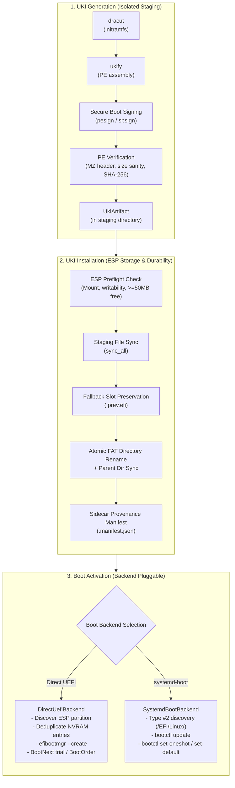

# RustyUKI Architecture & Pipeline

This document explains the internal design of RustyUKI, detailing the three-stage decoupled pipeline, atomic durability guarantees, boot backends, health assessment, and component responsibilities.

---

## High-Level Overview

RustyUKI provides a distribution-independent, failure-resistant lifecycle manager for Unified Kernel Images (UKIs).

Instead of treating UKI compilation, installation, and NVRAM boot activation as a single monolithic block, RustyUKI strictly separates them into three independent stages with isolated failure boundaries:

---

## Three-Stage Decoupled Pipeline

### Stage 1: UKI Generation

- **Scope**: Completely isolated in local staging storage (default: `/tmp/rustyuki-staging/` or configured staging path). Never touches the EFI System Partition or firmware variables.
- **Components**:
  1. **Initramfs Generation (`dracut`)**:
     Compiles kernel drivers, storage layers (LUKS, LVM, btrfs), and systemd early userspace into an isolated initramfs image. Supports `--sysroot` for offline targets.
  2. **PE/COFF Assembly (`ukify`)**:
     Combines the kernel executable (`vmlinuz`), initramfs, normalized command line, `os-release`, and optional boot splash bitmap.
  3. **Secure Boot Signing**:
     Optional signing stage using `pesign` (with NSS DB tokens) or `sbsign` (with PEM key/cert pairs).
  4. **PE Verification (`inspect_pe_artifact`)**:
     Validates the resulting PE binary: verifies DOS/PE magic header (`MZ`), validates that file size is reasonable and not zero/truncated, and computes cryptographic SHA-256 hash for provenance tracking.

### Stage 2: UKI Installation & Durability

- **Scope**: Transfers the validated artifact to the destination ESP directory (`/EFI/Linux/` or configured output directory).
- **Safety & Durability Guarantees**:
  - **FAT32 Power-Loss Durability**:
    Calling `rename()` on FAT32 filesystems is not inherently atomic or durable under sudden power loss. RustyUKI writes the staged binary to `.linux-<version>.efi.tmp`, issues `File::sync_all()` to ensure all data clusters are committed to disk, performs atomic rename, and then invokes `sync_all()` on the parent directory to flush directory cluster entries.
  - **Fallback Slot Preservation**:
    If an existing UKI is present at the target path, it is moved to `linux-<version>.prev.efi` before replacement. This ensures a known-working fallback boot artifact remains immediately available if the new UKI fails.
  - **Sidecar Provenance Manifest**:
    Every installed UKI is accompanied by a `linux-<version>.efi.manifest.json` file containing metadata: generator version, creation timestamp, SHA-256 hash, cmdline hash, kernel flavor, and backend type.
  - **Foreign UKI Protection**:
    Reconciliation and pruning strictly check provenance manifests. RustyUKI **never** deletes unmanaged or foreign UKIs created by other tools or distributions.

### Stage 3: Boot Activation

RustyUKI supports two pluggable boot management backends configured via `config.toml` (`[bootloader.backend]`):

#### 1. Direct UEFI Backend (`backend = "direct"`)
Firmware directly executes the UKI without intermediate bootloader code:
- **Partition Discovery**: Resolves the underlying block device and partition number via `findmnt` and `lsblk`.
- **Deduplication**: Audits existing NVRAM entries to avoid accumulating duplicate boot entries across kernel updates.
- **Trial Booting (`BootNext`)**: When trial boot is requested (or during initial installation), RustyUKI arms `BootNext` pointing to the new entry without modifying the default `BootOrder`.
- **Safe BootOrder Promotion**: During confirmation, the trial entry is promoted to index 0 of `BootOrder` and `BootNext` is cleared.

#### 2. systemd-boot Backend (`backend = "systemd-boot"`)
Uses `systemd-boot` to manage and launch Type #2 UKIs:
- **Type #2 Specification**: Discovers UKIs placed under `/EFI/Linux/`.
- **Synchronization**: Executes `bootctl update` to ensure bootloader binaries and partition metadata are synchronized.
- **Trial Booting**: Executes `bootctl set-oneshot <entry>` for one-time trial boots.
- **Default Promotion**: Promotes default kernel with `bootctl set-default <entry>`.

---

## Boot Confirmation & Health Assessment

A major architectural flaw in traditional boot managers is confirming a boot immediately upon reaching early systemd startup. If graphic drivers crash, storage filesystems fail to mount, or the machine falls into emergency mode, an unbootable kernel would be permanently promoted.

RustyUKI implements multi-stage health assessment:
1. `rustyuki-boot-confirm.service` is ordered strictly `After=multi-user.target graphical.target systemd-user-sessions.service`.
2. When invoked, `rustyuki confirm` evaluates system health via `systemctl is-system-running`.
3. If the system is in `emergency`, `rescue`, or `maintenance` mode, **confirmation is blocked**, and error diagnostics are emitted to journal logs.
4. Only when userspace has achieved normal healthy operational status is `BootOrder` or `bootctl set-default` finalized.
