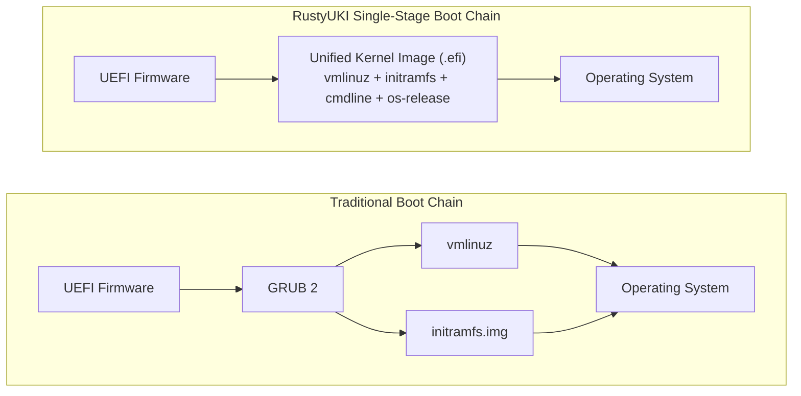
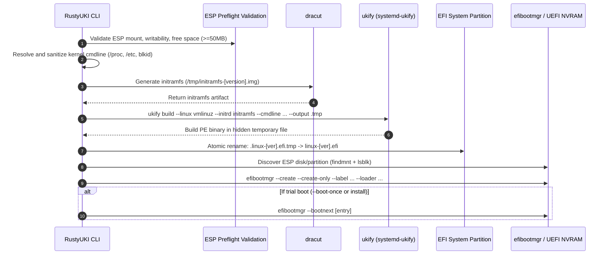

# RustyUKI Architecture & Pipeline

This document explains the internal design of RustyUKI, detailing the two-stage build pipeline, atomic file operations, EFI registration, and component responsibilities.

---

## High-Level Overview

RustyUKI replaces complex, multi-stage boot chains (UEFI firmware → GRUB core → GRUB modules → Linux kernel → initramfs) with a direct, single-binary execution path:

---

## The Two-Stage Build Pipeline

When `rustyuki generate` or `rustyuki install` is executed, RustyUKI carries out a coordinated pipeline:

### Stage 1: Initramfs Generation (`dracut`)

- **Binary**: `dracut`
- **Output Target**: `/tmp/initramfs-<kernel_version>.img`
- **Arguments**:
  - `-f`: Force overwrite any existing image in `/tmp`
  - Output path
  - Target kernel version string
  - User-configured extra arguments from `/etc/uki/uki.conf` (`[dracut.extra_args]`)

Dracut compiles the hardware drivers, filesystem modules (e.g., ext4, xfs, btrfs), storage layers (LVM, LUKS encryption), and systemd init scripts required to mount root during early userspace.

### Stage 2: UKI PE/COFF Assembly (`ukify`)

- **Binary**: `ukify` (provided by `systemd-ukify`)
- **Inputs**:
  - Kernel binary: `/lib/modules/<kernel_version>/vmlinuz`
  - Initramfs: `/tmp/initramfs-<kernel_version>.img`
  - Normalized command line: derived via cmdline detection hierarchy
  - OS metadata: `/etc/os-release`
  - Optional splash image: e.g. `/usr/share/pixmaps/fedora-logo.bmp`
  - User-configured extra arguments from `/etc/uki/uki.conf` (`[ukify.extra_args]`)
- **Target Output**: `/boot/efi/EFI/Linux/linux-<kernel_version>.efi`

### Atomic Write Guarantee

Writing a multi-megabyte kernel executable directly onto a FAT32 EFI System Partition carries risk: an interruption (out-of-disk space, power failure, SIGINT) could leave a half-written zero-byte executable in place of a working UKI.

RustyUKI guarantees atomic writes:
1. `ukify` writes the binary to a hidden temporary sibling file: `.linux-<version>.efi.tmp` in the target directory.
2. If `ukify` encounters an error, the temporary file is immediately removed.
3. Once `ukify` exits with status `0`, RustyUKI atomically moves `.linux-<version>.efi.tmp` to `linux-<version>.efi` via filesystem rename.

---

## EFI Boot Entry Registration

Once the UKI file is safely written to the ESP, RustyUKI registers it into the UEFI NVRAM:

1. **ESP Block Device Lookup**:
   - `findmnt -n -o SOURCE <esp_path>` identifies the underlying device (e.g. `/dev/nvme0n1p1`).
2. **Disk and Partition Extraction**:
   - `lsblk -no PKNAME <source>` discovers the parent disk (e.g. `nvme0n1`).
   - `lsblk -no PARTNUM <source>` determines the partition index (e.g. `1`).
3. **EFI Loader Path Conversion**:
   - Paths on UEFI are backslash-delimited and relative to the root of the ESP.
   - RustyUKI strips the ESP mountpoint prefix (`/boot/efi`) and converts slashes:
     `/boot/efi/EFI/Linux/linux-6.11.4.efi` $\rightarrow$ `\EFI\Linux\linux-6.11.4.efi`
4. **Non-Destructive Entry Creation**:
   - RustyUKI executes `efibootmgr` with `--create --create-only`.
   - `--create-only` creates the boot entry without automatically placing it at the front of `BootOrder`, preventing unwanted permanent overrides before verification.
5. **Entry ID Detection**:
   - By querying `efibootmgr --verbose` before and after entry creation, RustyUKI accurately identifies the assigned four-digit hexadecimal entry ID (e.g. `Boot0007`).

---

## Source Code Layout & Module Architecture

The RustyUKI codebase is strictly modularized:

| Module | File | Purpose |
|---|---|---|
| `main` | [`src/main.rs`](../src/main.rs) | CLI entrypoint, logging initialization, privilege enforcement (`require_root`), and subcommand routing. |
| `cli` | [`src/cli.rs`](../src/cli.rs) | Clap derive parser definitions for commands, global options, and argument structures. |
| `app` | [`src/app.rs`](../src/app.rs) | High-level orchestrator: coordinate generate, install, reconcile, status, and confirm flows. |
| `config` | [`src/config.rs`](../src/config.rs) | TOML configuration deserialization with Serde and safe defaults. |
| `dracut` | [`src/dracut.rs`](../src/dracut.rs) | Wraps dracut command generation and execution for stage 1. |
| `ukify` | [`src/ukify.rs`](../src/ukify.rs) | Wraps ukify assembly, handles temp file generation and atomic rename for stage 2. |
| `efi` | [`src/efi.rs`](../src/efi.rs) | UEFI NVRAM interactions via `efibootmgr`, ESP mount validation, space checks via `statvfs`, and loader path manipulation. |
| `kernel` | [`src/kernel.rs`](../src/kernel.rs) | Kernel discovery via `rpm -q kernel`, cmdline extraction and sanitization, UUID blkid verification, caching, and stale UKI pruning. |
| `hook` | [`src/hook.rs`](../src/hook.rs) | Generates and installs the Fedora `kernel-install` plugin script and the systemd `rustyuki-boot-confirm.service`. |
| `privilege` | [`src/privilege.rs`](../src/privilege.rs) | POSIX UID verification preventing unprivileged execution. |
| `cmd` | [`src/cmd.rs`](../src/cmd.rs) | Command execution abstraction (`CommandRunner` trait) allowing comprehensive mocked unit and integration testing without disk/EFI modification. |
| `error` | [`src/error.rs`](../src/error.rs) | Structured error definitions using `thiserror`. |
