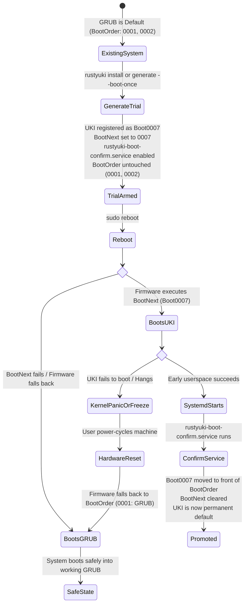

# Boot Safety & Trial Workflow

Replacing a system bootloader is inherently risky. RustyUKI implements defensive design principles, preflight checks, and a trial-boot state machine to protect systems from unbootable states.

---

## The Fail-Safe Trial Boot Workflow

Instead of immediately replacing your working GRUB boot entry or overwriting the permanent UEFI `BootOrder`, RustyUKI uses UEFI's standard `BootNext` mechanism.



### Step-by-Step Flow

1. **Trial Arming**:
   - `rustyuki install` (or `rustyuki generate --boot-once`) creates the UKI on the ESP.
   - Registers entry `Boot000X` with `efibootmgr --create --create-only`. The existing permanent `BootOrder` is not touched.
   - Sets `efibootmgr --bootnext 000X`.
   - Installs and enables `/etc/systemd/system/rustyuki-boot-confirm.service`.

2. **Reboot**:
   - Upon restart, the UEFI firmware inspects `BootNext`. It executes `Boot000X` for this single boot attempt only.
   - Firmware automatically clears the `BootNext` NVRAM variable before launching the OS.

3. **Automatic Confirmation on Success**:
   - As systemd initializes userspace before `network.target`, `rustyuki-boot-confirm.service` executes `rustyuki confirm`.
   - `rustyuki confirm` reads `BootCurrent` from UEFI NVRAM, places that entry ID at the front of `BootOrder`, and clears any residual `BootNext`.
   - The UKI is now your permanent primary bootloader.

4. **Fail-Safe Fallback on Failure**:
   - If the UKI fails to boot (e.g. kernel panic, freeze, missing filesystem driver), simply reboot or power-cycle the system.
   - Because `BootNext` is one-time only and `BootOrder` was not modified, the firmware immediately falls back to your existing bootloader (GRUB).

---

## Boot Confirmation Service

The unit file is installed at `/etc/systemd/system/rustyuki-boot-confirm.service`:

```ini
[Unit]
Description=Confirm successful RustyUKI trial boot
DefaultDependencies=no
After=local-fs.target
Before=network.target

[Service]
Type=oneshot
ExecStart=/usr/local/bin/rustyuki confirm

[Install]
WantedBy=multi-user.target
```

Because it specifies `DefaultDependencies=no` and runs `After=local-fs.target` and `Before=network.target`, it guarantees that confirmation happens as soon as root filesystems are mounted, yet cleanly before networking or display managers start.

---

## GPT Autodiscovery Advisory

The [UAPI Discoverable Partitions Specification (DPS)](https://uapi-group.org/specifications/specs/discoverable_partitions_specification/) allows `systemd-gpt-auto-generator` in the initramfs to find and mount the root partition automatically without needing a static `root=UUID=...` command line argument.

When running `sudo rustyuki status`, RustyUKI inspects your root partition's GPT type GUID and checks whether `root=` in your cmdline is necessary.

### Architecture DPS Root GUIDs Recognized by RustyUKI

| Architecture | Root Partition Type GUID |
|---|---|
| `x86_64` | `4f68bce3-e8cd-4db1-96e7-fbcaf984b709` |
| `aarch64` | `b921b045-1df0-41c3-af44-4c6f280d3fae` |
| `arm` / `armv7` | `69dad710-2ce4-4e3c-b16c-21a1d49abed3` |
| `x86` / `i386` | `44479540-f297-41b2-9af7-d131d5f0458a` |
| `riscv64` | `72ec70a6-cf74-40e6-bd49-4bda08e8f224` |
| `loongarch64` | `77055800-792c-4f94-b39a-98c91b762bb6` |

### Advisory Output

- **When root GUID matches DPS and `root=` is present:**
  ```text
  [INFO] Root partition carries a discoverable GPT GUID.
         'root=' in your cmdline may be unnecessary on this system.
         Consider removing it and testing with: rustyuki generate --dry-run
  ```
- **When root GUID matches DPS and `root=` is omitted:**
  ```text
  [OK] Cmdline has no 'root='. GPT autodiscovery will locate the root partition.
  ```

---

## ESP Preflight Validation Checks

Before any initramfs compilation or binary generation begins, RustyUKI runs rigorous preflight checks on the ESP:

1. **Mountpoint Existence**:
   - Confirms that `esp_path` exists and is a directory.
2. **Active Mount Check**:
   - Parses `/proc/mounts` to verify that `esp_path` is an actively mounted filesystem.
3. **Read-Only (`ro`) Detection**:
   - Inspects mount options in `/proc/mounts`. If the ESP is mounted `ro`, the build fails with an actionable remount command (`mount -o remount,rw <esp>`).
4. **Free Disk Space Verification via `statvfs`**:
   - Queries `f_bavail * f_frsize` via libc `statvfs`.
   - **Hard failure (< 50 MB)**: Refuses to build if available space is below 50 MB, preventing partial writes.
   - **Warning (< 150 MB)**: Emits a warning if available space is under 150 MB, as multiple UKIs or kernel updates could exhaust storage.
5. **Write Permission Verification**:
   - Verifies write access using `nix::libc::access(..., W_OK)` on the target output directory.
