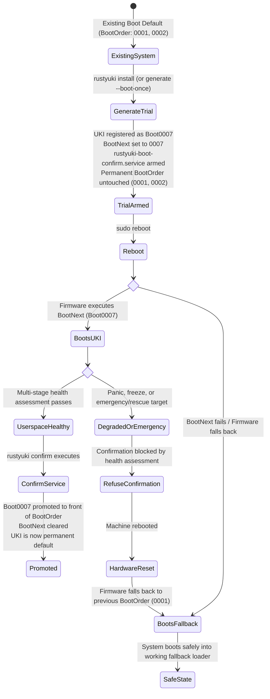

# Boot Safety & Trial Workflow

Modifying boot infrastructure carries real risk. RustyUKI implements defensive design principles, preflight safety checks, multi-stage health assessment, and a trial-boot state machine to protect systems from unbootable states.

---

## The Fail-Safe Trial Boot Workflow

Instead of immediately replacing your existing bootloader entry or overwriting the permanent UEFI `BootOrder`, RustyUKI leverages trial boot semantics:



---

## Multi-Stage Health Assessment vs. Premature Confirmation

A critical architectural flaw in early UKI prototypes was executing confirmation immediately after early root mount (`After=local-fs.target`, `Before=network.target`). At that stage, essential userspace subsystems (graphical targets, display servers, network management, core services) have not initialized. If a driver crashes or systemd drops into emergency mode, an unbootable kernel would be prematurely marked as successful.

RustyUKI implements **multi-stage boot health assessment**:

1. **Service Ordering**:
   `rustyuki-boot-confirm.service` is ordered late in the startup sequence:
   ```ini
   [Unit]
   Description=RustyUKI Boot Confirmation & Health Assessment
   Documentation=https://github.com/GlitchSlayed/RustyUKI
   After=multi-user.target graphical.target systemd-user-sessions.service
   Wants=multi-user.target

   [Service]
   Type=oneshot
   RemainAfterExit=yes
   ExecStart=/usr/bin/rustyuki confirm

   [Install]
   WantedBy=multi-user.target
   ```

2. **Target State Assessment**:
   When `rustyuki confirm` runs, it queries `systemctl is-system-running`:
   - `running`: System is healthy. Trial boot is promoted to permanent default.
   - `degraded`: Non-critical service failed, but userspace reached target. Evaluates failure severity and promotes with journal warning.
   - `emergency` / `rescue` / `maintenance`: **Confirmation is aborted immediately.** The trial boot entry is NOT promoted, ensuring that the machine will fall back to its prior boot path upon next reboot.

---

## FAT32 Durability, Logical Transactions & Firmware Limitations

EFI System Partitions are mandated by the UEFI specification to use FAT32 (or FAT16/12 on small media). FAT32 is an unjournaled, non-transactional filesystem without POSIX ACID guarantees. Standard assumptions about atomic directory updates under sudden power loss do not hold on FAT32.

RustyUKI distinguishes between **data cluster synchronization**, **logical transaction recovery**, **atomicity assumptions**, and **power-loss durability guarantees**:

### 1. Data Cluster Synchronization
- UKIs are initially staged either in temporary system storage or directly as hidden sibling files on the ESP (`.<target>.tmp`).
- Prior to renaming, an explicit `File::sync_all()` is executed on the open file handle. This ensures all binary data clusters (PE header, kernel, initramfs, cmdline) are flushed from the OS page cache to physical flash media before any directory pointers are modified.

### 2. Logical Transaction Recovery & Backup Preservation
- **Staging before Rename**: The target binary path (e.g. `linux-<version>.efi`) is never truncated or overwritten in-place.
- **Rollback Staging**: During rollback recovery, `linux-<version>.prev.efi` is copied into a temporary staging file (`.linux-<version>.efi.rollback.staging`) before being renamed over the active path. The `.prev.efi` recovery slot is preserved intact so repeated recovery attempts remain safe.
- **Sidecar Provenance Synchronization**: Metadata sidecars (`.manifest.json`) are written and synchronized following the exact same staging protocol.

### 3. VFAT Directory Synchronization Nuances
- On Linux, calling `fsync()` on a directory file descriptor on a FAT32 filesystem (`vfat`) frequently returns `EINVAL`, `ENOTSUP`, or `ENOSYS`, as the Linux VFAT kernel driver does not implement directory-level fsync.
- RustyUKI's `sync_directory_entry()` explicitly catches `EINVAL`, `ENOTSUP`, and `ENOSYS` when syncing parent directory entries, logging the limitation while treating it as non-fatal. Genuine I/O hardware errors (e.g. `EIO`, device disconnection) are strictly propagated.

### 4. Realistic Power-Loss Durability Guarantees
- **What is guaranteed**: If power fails during UKI generation or file copy, the existing active UKI and the `.prev.efi` backup remain unmodified and bootable. Zero-length or truncated files never replace active boot entries.
- **What is not guaranteed**: Because FAT32 lacks transactional journaling and block-level barriers across directory table updates, catastrophic hardware power loss occurring in the exact microsecond of a FAT directory cluster update cannot be made fully atomic by software alone. In such rare events, standard FAT cluster recovery or chkdsk is required. RustyUKI maximizes safety within the fundamental constraints of UEFI FAT32 media.

---

## Fallback Slots (`.prev.efi`) and Provenance Tracking

### Automatic Fallback Preservation
When deploying a new UKI for kernel `<version>`, if an existing `linux-<version>.efi` is already installed, RustyUKI moves it to `linux-<version>.prev.efi` before overwriting. If the new kernel fails or exhibits regressions, running:
```bash
sudo rustyuki rollback --kernel <version>
```
immediately restores the previous working binary without recompilation.

### Sidecar Provenance Manifests
Every UKI deployed by RustyUKI is accompanied by a metadata sidecar:
`/efi/EFI/Linux/linux-<version>.efi.manifest.json`

This records:
- Generator name and version (`rustyuki 0.2.0`)
- Exact target kernel version and distribution flavor (Fedora / CachyOS / Generic)
- SHA-256 binary hash
- Embedded command-line hash
- Boot backend targeted (`direct` or `systemd-boot`)

**Foreign UKI Protection**:
During kernel pruning or reconciliation, RustyUKI inspects provenance sidecars. Any UKI missing a valid RustyUKI manifest is treated as an unmanaged or foreign UKI and will **never** be deleted.

---

## GPT Autodiscovery Advisory

The [UAPI Discoverable Partitions Specification (DPS)](https://uapi-group.org/specifications/specs/discoverable_partitions_specification/) allows `systemd-gpt-auto-generator` in the initramfs to find and mount the root partition automatically without needing a static `root=UUID=...` command line argument.

When running `sudo rustyuki status`, RustyUKI inspects your root partition's GPT type GUID and checks whether `root=` in your cmdline is necessary.

### Architecture DPS Root GUIDs Recognized by RustyUKI

| Architecture | Root Partition Type GUID |
|---|---|
| `x86_64` | `4f68bce3-e8cd-4db1-96e7-fbcaf984b709` |
| `aarch64` | `b921b045-1df0-41c3-af44-4c6f280d3fae` |
| `arm` / `armv7` | `69dad710-2ce4-4e3c-b16c-21a1d49abed3` |
| `x86` / `i386` | `44479540-f297-41b2-9af7-d131d5f0458a` |
| `riscv64` | `72ec70a6-cf74-40e6-bd49-4bda08e8f224` |
