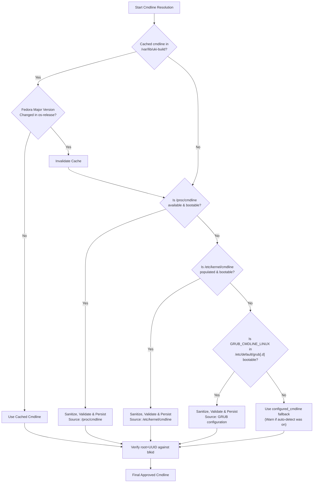

# RustyUKI Configuration Guide

RustyUKI reads its configuration from `/etc/uki/uki.conf` by default. You can override this location using the `--config <PATH>` global CLI option.

If the configuration file does not exist, RustyUKI operates with built-in safe defaults.

---

## Configuration File Format

The configuration file is formatted in standard TOML. Below is a complete, annotated example:

```toml
[uki]
# Kernel version to build. If left empty, RustyUKI defaults to `uname -r`.
kernel_version = ""

# Mountpoint of the EFI System Partition (ESP).
esp_path = "/boot/efi"

# Output directory on the ESP where .efi UKI binaries will be written.
output_dir = "/boot/efi/EFI/Linux"

# Path to the file containing kernel boot parameters.
cmdline_file = "/etc/kernel/cmdline"

# Fallback kernel command line used if auto-detection fails.
configured_cmdline = "root=UUID=REPLACE-ME rw quiet rhgb"

# Automatically detect kernel cmdline from system sources (/proc, /etc, GRUB).
auto_detect_cmdline = true

# Directory storing cached cmdline metadata and detection state.
cmdline_state_dir = "/var/lib/uki-build"

# Warn if cmdline has fewer tokens than this threshold after sanitization.
cmdline_min_tokens = 3

# Optional: Path to a splash/logo image (BMP or PNG) to embed in the UKI.
splash = ""

# Path to the os-release file embedded in the UKI PE .osrel section.
os_release = "/etc/os-release"

[dracut]
# Additional command-line flags passed directly to dracut during stage 1.
extra_args = []

[ukify]
# Additional command-line flags passed directly to ukify during stage 2.
extra_args = []
```

---

## Configuration Reference

### `[uki]` Section

| Key | Type | Default | Description |
|---|---|---|---|
| `kernel_version` | String | `""` | Target kernel version. An empty string instructs RustyUKI to query the running kernel via `uname -r`. |
| `esp_path` | String (Path) | `"/boot/efi"` | Path where the EFI System Partition is mounted. Must be an active mountpoint. |
| `output_dir` | String (Path) | `"/boot/efi/EFI/Linux"` | Directory where generated `.efi` images are stored. Created automatically if missing. |
| `cmdline_file` | String (Path) | `"/etc/kernel/cmdline"` | File containing the kernel command line parameters. |
| `configured_cmdline` | String | `"root=UUID=REPLACE-ME rw quiet rhgb"` | Static fallback command line if auto-detection fails or is disabled. |
| `auto_detect_cmdline` | Boolean | `true` | When `true`, automatically discovers the optimal boot parameters from running system state. |
| `cmdline_state_dir` | String (Path) | `"/var/lib/uki-build"` | State directory for persistent detection metadata. |
| `cmdline_min_tokens` | Integer | `3` | Emits a warning if the resolved command line contains fewer parameters than this threshold. |
| `splash` | String (Path) | `""` | Optional path to a splash image embedded into the PE binary. |
| `os_release` | String (Path) | `"/etc/os-release"` | Distribution metadata file embedded into the UKI. |

### `[dracut]` Section

| Key | Type | Default | Description |
|---|---|---|---|
| `extra_args` | Array of Strings | `[]` | Extra CLI arguments appended to `dracut -f <out> <ver>`. |

**Example:**
```toml
[dracut]
extra_args = [
    "--force-drivers", "nvme btrfs",
    "--omit", "plymouth"
]
```

### `[ukify]` Section

| Key | Type | Default | Description |
|---|---|---|---|
| `extra_args` | Array of Strings | `[]` | Extra CLI arguments appended to `ukify build ...`. |

**Example:**
```toml
[ukify]
extra_args = [
    "--measure",
    "--pcr-banks", "sha256"
]
```

---

## Kernel Command Line Resolution Hierarchy

Because kernel parameters are compiled directly into the UKI binary, an invalid or missing command line will render the UKI unbootable.

When `auto_detect_cmdline = true`, RustyUKI uses a prioritized discovery pipeline:



### 1. Token Sanitization
Regardless of source, parameters that are irrelevant or problematic for UKIs are automatically stripped:
- `BOOT_IMAGE=...` (specific to GRUB's kernel loader)
- `initrd=...` (initramfs is bundled inside the UKI binary itself)
- `rd.driver.blacklist=...`

### 2. Major Version Invalidation
Cached parameters are stored in `/var/lib/uki-build/cmdline/effective-cmdline` alongside `/var/lib/uki-build/cmdline/version-id`. When upgrading Fedora releases (e.g. Fedora 44 $\rightarrow$ Fedora 45), the cache is automatically invalidated to discover updated distribution parameters.

### 3. Safety Validations
- **Placeholder Rejection**: If the command line contains `root=UUID=REPLACE-ME`, the build is aborted immediately.
- **UUID Verification via `blkid`**: If a `root=UUID=<uuid>` parameter is present, RustyUKI executes `blkid -t UUID=<uuid>`. If the block device does not exist, the build is aborted to prevent creating an unbootable UKI.
- **Minimum Token Warning**: If the sanitized cmdline has fewer than `cmdline_min_tokens`, a warning is logged.
