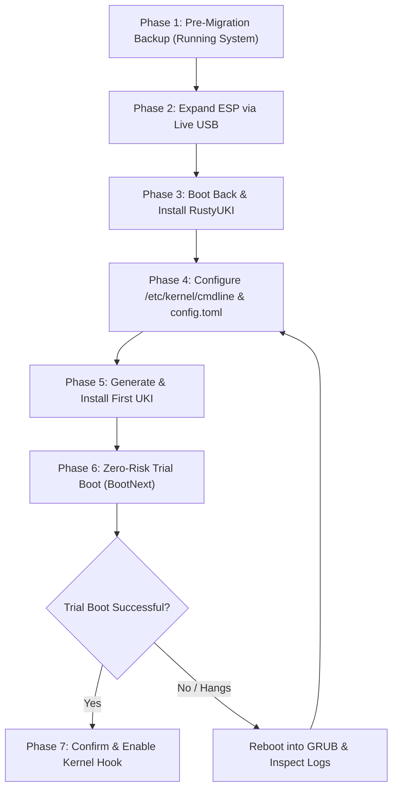

# Migrating an Existing Fedora Installation to RustyUKI

This guide walks you through migrating an existing, conventional Fedora Workstation or Server installation (Fedora 39, 40, 41, 42, 43, 44, or 45+) from traditional GRUB2/BLS boot to **RustyUKI** Unified Kernel Images (UKIs).

---

## Overview

### Traditional Fedora Boot vs. Unified Kernel Images

| Feature | Traditional Fedora (GRUB2 + BLS) | RustyUKI (Unified Kernel Image) |
|---|---|---|
| **Boot Chain** | Firmware → Shim → GRUB2 → Kernel + Initramfs | Firmware → Monolithic UKI (`.efi`) |
| **Artifacts on Disk** | Separate `vmlinuz`, `initramfs`, and BLS `.conf` entries in `/boot` | Single self-contained PE binary (`/boot/efi/EFI/Linux/linux-<version>.efi`) |
| **Command Line Security** | Stored in cleartext configuration files (`/boot/loader/entries/`, `/etc/default/grub`) | Embedded cryptographically inside the signed PE `.cmdline` section |
| **Firmware Execution** | Relies on GRUB's filesystem and partition drivers | Native UEFI PE/COFF loader (`efibootmgr`) or clean `systemd-boot` discovery |
| **Boot Time** | Slower; multiple boot stages, disk timeouts, menu delays | Near-instant; direct firmware execution without intermediate bootloaders |
| **Failure Recovery** | Manual GRUB menu selection | Automated `BootNext` trial booting and instant `.prev.efi` fallback slots |

### The Safety-First Approach

Migrating to RustyUKI is **non-destructive to your existing GRUB setup**. You do not need to delete GRUB, remove shim, or wipe your existing `/boot` partition. GRUB remains registered in your UEFI NVRAM as a permanent or fallback entry until you are completely satisfied with your new UKI configuration.

---

## The Core Challenge: EFI System Partition (ESP) Sizing

### Why Fedora's Default ESP is Too Small

On a standard Fedora installation, the Anaconda installer traditionally provisions an EFI System Partition (ESP) of only **200 MiB to 600 MiB** at `/boot/efi`.

A Unified Kernel Image bundles:
1. The compressed Linux kernel binary (`vmlinuz`, ~15 MiB)
2. The initramfs image including storage drivers, microcode, and systemd modules (~60–120 MiB; larger with proprietary NVIDIA drivers or DKMS modules)
3. Distribution metadata and kernel command line parameters

This produces a single `.efi` binary of roughly **75 MiB to 140 MiB** per kernel.

Fedora retains three kernels by default (`installonly_limit=3`). With RustyUKI's safety architecture:
- 3 active kernels: ~250–450 MiB
- Previous working fallback slots (`.prev.efi`): ~250–450 MiB
- Staging headroom during kernel upgrades (`dnf update kernel`): ~150 MiB
- Auxiliary EFI tools (systemd-boot, memtest86+, UEFI shell, firmware update capsules): ~50–100 MiB

> [!IMPORTANT]
> **Recommended ESP size: 4.0 GiB (4096 MiB).**
>
> While 1.0–2.0 GiB can function for minimal setups, allocating **4.0 GiB** guarantees:
> - Ample room for 3–5 concurrent kernel packages plus `.prev.efi` fallback slots.
> - Full capacity for heavy initramfs builds containing proprietary NVIDIA GPU modules, complex storage/RAID drivers, or debug symbols.
> - Generous scratch and staging headroom so atomic replacements never encounter `ENOSPC`.
> - Sufficient space to host `systemd-boot`, diagnostic tools, or multi-boot kernels without partition constraint.
>
> If your existing ESP is only 200–600 MiB, you **must expand the ESP to 4 GiB** before installing UKIs.

---

## Migration Workflow



---

## Phase 1: Pre-Migration Backup & Assessment

Perform these steps from your **running Fedora installation** before touching any partitions.

### 1. Check Your Current Disk & Partition Layout

Inspect your partition layout, filesystem types, and current ESP usage:

```bash
lsblk -o NAME,SIZE,FSTYPE,LABEL,MOUNTPOINTS
df -h /boot/efi
```

Typically, on a UEFI Fedora machine, you will see:
- `/dev/nvme0n1p1` (or `sda1`): `vfat`, mounted at `/boot/efi` (ESP, usually 200–600M)
- `/dev/nvme0n1p2` (or `sda2`): `ext4`, mounted at `/boot` (usually 1G)
- `/dev/nvme0n1p3` (or `sda3`): `btrfs`, mounted at `/` and `/home` (root subvolumes)

### 2. Back Up the Existing ESP

Archive your entire current EFI directory to a safe location (e.g. your home directory or an external flash drive):

```bash
sudo tar -czvf /root/esp-backup-$(date +%Y%m%d).tar.gz /boot/efi
```

### 3. Back Up UEFI NVRAM Boot Entries

Export all existing firmware boot entries:

```bash
efibootmgr -v > /root/efibootmgr-backup-$(date +%Y%m%d).txt
```

### 4. Back Up `/etc/fstab`

```bash
sudo cp /etc/fstab /etc/fstab.bak
```

### 5. Capture Your Kernel Command Line

Verify and record your current working kernel command line parameters:

```bash
cat /proc/cmdline
```

Note the `root=UUID=...` and any specific parameters (e.g., `rhgb`, `quiet`, `rd.luks.uuid=...`).

### 6. Prepare a Fedora Live USB

Flash an official Fedora Workstation Live image (or GParted Live image) to a USB drive using Fedora Media Writer or `dd`. You will need this to resize the ESP without partition lock contention.

---

## Phase 2: Expanding the EFI System Partition (ESP)

Because the ESP is located at the physical beginning of your drive and is immediately followed by other active partitions (such as `/boot` or your root filesystem), it cannot be grown while those filesystems are mounted and in use.

### Step 1: Boot into the Live USB

1. Insert your Fedora Workstation Live USB.
2. Reboot your computer and press the boot menu key (`F12`, `F11`, `F10`, or `Esc` depending on your motherboard).
3. Select the Live USB and choose **"Try Fedora"**.
4. Open the **Terminal**.

---

### Method A: Graphical Resizing with GParted (Recommended)

1. In the Live desktop, install and launch GParted:
   ```bash
   sudo dnf install -y gparted && sudo gparted
   ```
2. Select your internal disk from the top-right dropdown (e.g. `/dev/nvme0n1` or `/dev/sda`).
3. Examine the partition order:
   - **Partition 1 (ESP)**: `vfat`, size ~200–600 MiB.
   - **Partition 2 (`/boot`)**: `ext4`, size ~1 GiB.
   - **Partition 3 (Root)**: `btrfs` or `ext4`/`xfs`.

4. **Create space for the ESP**:
   - If you have an adjacent `/boot` partition (`Partition 2`):
     - Right-click Partition 3 (Root) → **Resize/Move** → Shrink the start/left boundary by ~3.5–4.0 GiB (freeing up ~4000 MiB preceding space).
     - Right-click Partition 2 (`/boot`) → **Resize/Move** → Move Partition 2 to the right into the unallocated space.
   - If your root partition directly follows Partition 1 (no separate `/boot`):
     - Right-click Partition 2 (Root) → **Resize/Move** → Drag the left slider rightward to leave 4.0 GiB of unallocated space before it.

5. **Grow the ESP**:
   - Right-click Partition 1 (ESP) → **Resize/Move**.
   - Drag the right boundary to fill the newly freed unallocated space until the partition reaches **4.0 GiB (4096 MiB)**.
   - Ensure the partition type remains `vfat` / `fat32`.

6. **Apply the Changes**:
   - Click the green checkmark (**Apply All Operations**).
   - GParted will relocate partition boundaries, move the filesystem blocks, and run `fatresize` to expand the FAT32 filesystem cleanly to 4.0 GiB.

---

### Method B: Command-Line Resizing (For Headless or Advanced Setups)

If GParted is not available or you are working in a terminal environment:

#### 1. Identify Disk and Block Locations
```bash
sudo parted /dev/nvme0n1 unit MiB print
```

#### 2. Backup ESP Contents to Temporary Storage
```bash
sudo mkdir -p /tmp/esp /tmp/esp-backup
sudo mount /dev/nvme0n1p1 /tmp/esp
sudo cp -a /tmp/esp/* /tmp/esp-backup/
sudo umount /tmp/esp
```

#### 3. Adjust Adjacent Partition Boundaries
If Partition 2 (`/boot`) is immediately adjacent to Partition 1, you can shrink or move it using standard tools:
```bash
# Shrink ext4 /boot filesystem first
sudo e2fsck -f /dev/nvme0n1p2
sudo resize2fs /dev/nvme0n1p2 800M

# Use parted to expand partition 1 (ESP) to 4096 MiB (4 GiB)
sudo parted /dev/nvme0n1 unit MiB resizepart 1 4096MiB
```

#### 4. Resize or Recreate the FAT Filesystem
If the partition size was changed, expand the filesystem:
```bash
sudo fatresize -s 4096M /dev/nvme0n1p1 || sudo dosfsck -w -r -l -a -v -t /dev/nvme0n1p1
```

> [!CAUTION]
> If you recreate the FAT32 filesystem using `mkfs.fat -F32 /dev/nvme0n1p1`:
> 1. You **must restore** the backed-up files from `/tmp/esp-backup/`.
> 2. The partition will receive a **new UUID**.
> 3. You **must mount your root partition** and update `/etc/fstab` with the new UUID before rebooting:
>    ```bash
>    # Get new ESP UUID
>    NEW_UUID=$(lsblk -no UUID /dev/nvme0n1p1)
>    echo "New ESP UUID is: ${NEW_UUID}"
>
>    # Mount root and update fstab
>    sudo mount /dev/nvme0n1p3 /mnt -o subvol=root # for Btrfs
>    sudo sed -i "s/UUID=[A-Fa-f0-9-]\{9,\}\s*\/boot\/efi/UUID=${NEW_UUID} \/boot\/efi/" /mnt/etc/fstab
>    sudo umount /mnt
>    ```

---

## Phase 3: Boot Back & Install Packages

Reboot your computer, remove the Live USB, and boot back into your installed Fedora system (using your standard GRUB bootloader).

### 1. Verify ESP Expansion

Log into your Fedora system and check that the ESP has expanded to **4.0 GiB**:

```bash
df -h /boot/efi
```

The `Size` column should now show **~4.0G**, with roughly 3.8G to 3.9G of free space.

### 2. Choose Your Boot Backend

RustyUKI supports two distinct, first-class bootloader architectures. Decide which backend matches your requirements:

| Criterion | Option A: Direct UEFI (`direct`) | Option B: systemd-boot (`systemd-boot`) |
|---|---|---|
| **Architecture** | Firmware directly executes the `.efi` UKI | Lightweight intermediate UEFI bootloader menu |
| **Boot Speed** | Fastest possible (zero bootloader overhead) | Fast; optional menu with configurable timeout |
| **Boot Menu** | Firmware boot menu (`F11`/`F12`) | Built-in systemd-boot interactive menu |
| **Multi-Kernel UI** | Accessed via motherboard boot manager | Visual menu to pick previous kernels or reboot into firmware |
| **Trial Mechanism** | UEFI NVRAM variable (`BootNext`) | `bootctl set-oneshot` / `systemd-bless-boot` |
| **Dependencies** | `efibootmgr` | `systemd-boot`, `bootctl` |
| **Best For** | Minimalists, dedicated single-OS workstations, Secure Boot | Users wanting a visual boot menu, multi-kernel picking |

### 3. Install Required Dependencies

#### Common Dependencies (Required for Both Backends)
```bash
sudo dnf install -y \
  dracut \
  systemd-ukify \
  binutils \
  efibootmgr
```

#### Additional Dependency (If Choosing Option B: systemd-boot)
```bash
sudo dnf install -y systemd-boot
```

### 4. Install RustyUKI

Install RustyUKI using the prebuilt RPM package or compile from source:

#### Option A: From RPM Package (Recommended)
```bash
sudo dnf install -y ./rustyuki-*.x86_64.rpm
```

#### Option B: From Source
```bash
git clone https://github.com/GlitchSlayed/RustyUKI.git
cd RustyUKI
cargo build --release --locked
sudo install -Dpm0755 target/release/rustyuki /usr/bin/rustyuki
sudo install -Dpm0644 packaging/systemd/rustyuki-boot-confirm.service /usr/lib/systemd/system/rustyuki-boot-confirm.service
sudo mkdir -p /etc/rustyuki
sudo cp packaging/config.toml /etc/rustyuki/config.toml
```

---

## Phase 4: Configure Command Line & Backend

### 1. Configure Persistent Kernel Command Line

In traditional Fedora, GRUB generates command line arguments dynamically. RustyUKI embeds the kernel command line directly into the UKI binary for tamper resistance.

Inspect your running arguments and write them to `/etc/kernel/cmdline`:

```bash
# View active arguments
cat /proc/cmdline

# Create /etc/kernel/cmdline with required parameters:
# (Strip ephemeral parameters like BOOT_IMAGE=)
ROOT_UUID=$(findmnt -n -o UUID /)
echo "root=UUID=${ROOT_UUID} ro quiet rhgb" | sudo tee /etc/kernel/cmdline
```

> [!TIP]
> If you use Btrfs subvolumes, LUKS encryption, or resume devices, make sure they are included:
> ```bash
> root=UUID=<root-uuid> rootflags=subvol=root ro quiet rhgb rd.luks.uuid=<luks-uuid>
> ```

---

### 2. Configure `/etc/rustyuki/config.toml`

Choose your configuration based on your chosen backend:

````carousel
```toml
# --- OPTION A: DIRECT UEFI BACKEND (Recommended for minimal boot) ---
[uki]
esp_path = "/boot/efi"
output_dir = "/boot/efi/EFI/Linux"
auto_detect_cmdline = true
cmdline_file = "/etc/kernel/cmdline"
cmdline_state_dir = "/var/lib/uki-build"
cmdline_min_tokens = 3

[bootloader]
backend = "direct"
trial_boot = true
keep_backup = true
prune_stale_images = true

[dracut]
extra_args = []

[ukify]
extra_args = []

[signing]
enabled = false
```
<!-- slide -->
```toml
# --- OPTION B: SYSTEMD-BOOT BACKEND (Recommended for visual boot menu) ---
[uki]
esp_path = "/boot/efi"
output_dir = "/boot/efi/EFI/Linux"
auto_detect_cmdline = true
cmdline_file = "/etc/kernel/cmdline"
cmdline_state_dir = "/var/lib/uki-build"
cmdline_min_tokens = 3

[bootloader]
backend = "systemd-boot"
trial_boot = true
keep_backup = true
prune_stale_images = true

[dracut]
extra_args = []

[ukify]
extra_args = []

[signing]
enabled = false
```
````

---

### 3. Initialize systemd-boot on ESP (Option B Only)

If you selected **Option B (`systemd-boot`)**, you must initialize systemd-boot binaries and configuration on your ESP:

```bash
# Install systemd-boot to ESP
sudo bootctl install --esp-path=/boot/efi

# Verify installation status
sudo bootctl status --esp-path=/boot/efi
```

This creates `/boot/efi/EFI/systemd/systemd-bootx64.efi` and initializes `/boot/efi/loader/loader.conf`. You can optionally set a menu timeout:
```bash
echo "timeout 3" | sudo tee -a /boot/efi/loader/loader.conf
```

*(If you selected Option A: Direct UEFI, skip this step; firmware boots UKIs directly without an intermediate bootloader binary).*

---

## Phase 5: Generate & Install Your First UKI

Both backends share the same atomic build and installation pipeline.

### 1. Perform a Dry Run (Inspection)

Preview the generation and inspect parameters without modifying the ESP:

```bash
sudo rustyuki generate --verbose
```

RustyUKI will invoke `dracut` to stage the initramfs, run `ukify` to assemble the PE binary, and verify that all PE sections (`.linux`, `.initrd`, `.cmdline`, `.osrel`) are present.

### 2. Install the UKI to the ESP

```bash
sudo rustyuki install
```

What occurs during installation:
1. Validates that the ESP has >=50MB free space (with our 4.0G ESP, you have plenty of room).
2. Atomically copies the `.efi` binary to `/boot/efi/EFI/Linux/linux-<version>.efi`.
3. Issues durable filesystem flushes (`sync_all()`).
4. Generates the sidecar provenance manifest (`linux-<version>.efi.manifest.json`).

> [!NOTE]
> For **systemd-boot**, placing the binary in `/boot/efi/EFI/Linux/` is all that is required for boot discovery! Under the [Boot Loader Specification Type #2](https://uapi-group.org/specifications/specs/boot_loader_specification/), `systemd-boot` automatically discovers all `.efi` binaries in `/EFI/Linux/` without needing individual loader config files.

### 3. Verify the Installed Artifacts

```bash
# Check filesystem
ls -lh /boot/efi/EFI/Linux/

# Check status via RustyUKI CLI
rustyuki status
```

---

## Phase 6: Zero-Risk Trial Boot

RustyUKI implements a **strictly fail-safe trial boot workflow** tailored for each backend.

### 1. Arm the Trial Boot

Run the activation command with `--trial`:

```bash
sudo rustyuki activate --trial
```

#### Under the Hood:

- **If using Option A (Direct UEFI)**:
  RustyUKI registers an entry `RustyUKI (Linux <version>)` pointing to `\EFI\Linux\linux-<version>.efi` in NVRAM and sets the UEFI `BootNext` pointer to it. Your existing GRUB `BootOrder` is unmodified.
- **If using Option B (systemd-boot)**:
  RustyUKI executes `bootctl set-oneshot` pointing to `linux-<version>.efi`. systemd-boot will select this entry for the next boot only.

> [!IMPORTANT]
> Both `BootNext` and `set-oneshot` apply to **one boot attempt only**.
> If the UKI fails to boot, panics, or hangs, simply press the reset button or power cycle your computer.
> The firmware/bootloader will automatically fall back to your normal GRUB bootloader!

### 2. Reboot the System

```bash
sudo systemctl reboot
```

Watch the boot sequence:
- **Direct UEFI**: Firmware immediately executes `linux-<version>.efi` without showing any bootloader menu.
- **systemd-boot**: The systemd-boot menu appears with `linux-<version>.efi` highlighted as the active one-shot selection.
- The Linux kernel initializes hardware, mounts root via the embedded command line, and brings up systemd.
- You arrive at your standard Fedora login screen or desktop.

---

## Phase 7: Confirm Boot & Automate Kernel Updates

Once you have successfully booted into userspace via your new UKI:

### 1. Permanently Confirm the Bootloader Entry

Open a terminal and run:

```bash
sudo rustyuki confirm
```

RustyUKI assesses late-userspace health (verifying `default.target` is active, system is not degraded, and no emergency shell is active):
- **Direct UEFI**: Permanently moves the RustyUKI entry to the primary slot in UEFI `BootOrder`.
- **systemd-boot**: Calls `systemd-bless-boot good` and clears any lingering oneshot trial state.

### 2. Enable Automatic Boot Confirmation

Enable the confirmation systemd unit so future trial boots confirm automatically after reaching userspace:

```bash
sudo systemctl enable --now rustyuki-boot-confirm.service
```

### 3. Install the Automatic `kernel-install` Hook

Integrate RustyUKI with Fedora's standard package manager lifecycle:

```bash
sudo rustyuki install-hook
```

This installs `/usr/lib/kernel/install.d/90-rustyuki.install`. Whenever `dnf` installs or removes a kernel (`dnf update kernel`):
- `90-rustyuki.install` builds the new UKI automatically.
- Preserves the previous working UKI as `linux-<version>.prev.efi`.
- Updates boot entries and trial-arms the new kernel for the next reboot.
- Prunes obsolete kernels and manifest records during package removal.

---

## Phase 8: Post-Migration Optimization & Cleanup (Optional)

Once you have completed several successful reboots and a kernel update using RustyUKI:

### 1. Keep GRUB as a Secondary Fallback

You do **not** need to uninstall GRUB. Keeping GRUB installed in `/boot/efi/EFI/fedora/` gives you a permanent backup method accessible from your motherboard's `F12` boot menu.

### 2. Disable Duplicate BLS Entry Creation (Optional)

If you do not want `kernel-install` to generate redundant legacy GRUB loader entries in `/boot/loader/entries/`, you can mask the default loaderentry plugin:

```bash
sudo systemctl mask 90-loaderentry.install
```

Or set the preferred layout in `/etc/kernel/install.conf`:
```ini
layout=uki
```

---

## Troubleshooting & Emergency Runbook

### Problem 1: Emergency Shell: `dracut-initqueue timeout` / `Cannot find root`
- **Cause**: Kernel command line in `/etc/kernel/cmdline` is missing `root=UUID=...` or has an incorrect UUID.
- **Fix**:
  1. Reboot (system will boot into GRUB automatically due to `BootNext` expiry).
  2. Verify your root UUID with `findmnt -no UUID /`.
  3. Update `/etc/kernel/cmdline`.
  4. Regenerate and reinstall: `sudo rustyuki generate --install && sudo rustyuki activate --trial`.

### Problem 2: Firmware Rejects Execution / Jumps to BIOS Setup
- **Cause**: UEFI Secure Boot is enabled, but the UKI is unsigned.
- **Fix**:
  - Either enroll your custom Machine Owner Key (MOK) and configure `[signing]` in `/etc/rustyuki/config.toml` (`tool = "sbsign"`), or temporarily disable Secure Boot in UEFI firmware setup to complete migration.

### Problem 3: `efibootmgr: No space left on device`
- **Cause**: Motherboard NVRAM variable storage is cluttered with stale or dead boot entries.
- **Fix**:
  1. Inspect entries: `efibootmgr -v`.
  2. Remove dead entries: `sudo efibootmgr -b <entry-number> -B`.

### Problem 4: Need to Revert to GRUB Completely
If at any point you wish to return to standard GRUB:
```bash
# View existing entries
efibootmgr

# Set GRUB (usually labeled 'Fedora') as top boot order
sudo efibootmgr -o <grub_entry_num>,...

# Remove RustyUKI kernel hook
sudo rm -f /usr/lib/kernel/install.d/90-rustyuki.install
sudo systemctl disable rustyuki-boot-confirm.service
```
Your original GRUB installation remains completely intact and functional.
