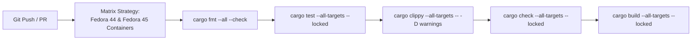

# Packaging & Continuous Integration

This guide documents the RPM packaging specification, CI validation pipelines, and automated nightly release workflows for RustyUKI targeting **Fedora 44** and **Fedora 45**.

---

## RPM Specification

The RPM spec file is located at [`.github/rpm/rustyuki.spec`](../.github/rpm/rustyuki.spec):

```spec
Name:           rustyuki
Version:        0.2.0
Release:        1%{?dist}
Summary:        Reliable, distribution-independent Unified Kernel Image lifecycle manager

License:        MIT
URL:            https://github.com/GlitchSlayed/RustyUKI
Source0:        %{name}-%{version}.tar.gz

BuildRequires:  cargo
BuildRequires:  rust
BuildRequires:  systemd-rpm-macros

Requires:       dracut
Requires:       systemd-ukify
Requires:       efibootmgr
Requires:       systemd-boot
Requires:       systemd-udev
Requires:       binutils

Recommends:     sbsign
Recommends:     pesign

%{?systemd_requires}

%description
RustyUKI is a failure-resistant Unified Kernel Image (UKI) manager for Linux systems.
It provides distinct generation, installation, and activation stages, supporting both
Direct UEFI and systemd-boot backends, multi-stage health assessment, safe fallback slots,
CachyOS and Fedora kernel compatibility, and offline sysroot generation.

%prep
%autosetup -n %{name}-%{version}

%build
cargo build --release --locked

%install
# Binary
install -Dpm0755 target/release/rustyuki %{buildroot}%{_bindir}/rustyuki

# Configuration
install -Dpm0644 packaging/config.toml %{buildroot}%{_sysconfdir}/rustyuki/config.toml

# kernel-install hook
install -Dpm0755 packaging/90-rustyuki.install %{buildroot}%{_prefix}/lib/kernel/install.d/90-rustyuki.install

# Systemd boot confirmation unit
install -Dpm0644 packaging/rustyuki-boot-confirm.service %{buildroot}%{_unitdir}/rustyuki-boot-confirm.service

# State directory for failure tracking and cmdline hash cache
install -d -m 0755 %{buildroot}%{_sharedstatedir}/uki-build

%post
%systemd_post rustyuki-boot-confirm.service

%preun
%systemd_preun rustyuki-boot-confirm.service

%postun
%systemd_postun_with_restart rustyuki-boot-confirm.service

%files
%license LICENSE
%doc README.md
%{_bindir}/rustyuki
%dir %{_sysconfdir}/rustyuki
%config(noreplace) %{_sysconfdir}/rustyuki/config.toml
%{_prefix}/lib/kernel/install.d/90-rustyuki.install
%{_unitdir}/rustyuki-boot-confirm.service
%dir %{_sharedstatedir}/uki-build
```

### Local RPM Build

To build an RPM locally on a Fedora workstation:

```bash
# 1. Install packaging tools
sudo dnf install -y git rpm-build rpmdevtools cargo rust systemd-rpm-macros

# 2. Set up the RPM build tree
rpmdev-setuptree

# 3. Create the source archive
VERSION="0.2.0"
git archive --format=tar.gz --prefix="rustyuki-${VERSION}/" -o ~/rpmbuild/SOURCES/rustyuki-${VERSION}.tar.gz HEAD

# 4. Copy and build the spec
cp .github/rpm/rustyuki.spec ~/rpmbuild/SPECS/
rpmbuild -ba ~/rpmbuild/SPECS/rustyuki.spec

# 5. Resulting packages
ls -l ~/rpmbuild/RPMS/*/*.rpm
ls -l ~/rpmbuild/SRPMS/*.rpm
```

---

## Continuous Integration (`checks.yml`)

The repository runs continuous validation across a matrix of the latest two Fedora releases (**Fedora 44** and **Fedora 45**) on every push and pull request via [`.github/workflows/checks.yml`](../.github/workflows/checks.yml):



### Features Verified:
- **Matrix Testing**: Validates code and dependencies against Fedora 44 (`fedora:44`) and Fedora 45 (`fedora:45`).
- **Rustfmt Compliance**: Ensures consistent formatting across all modules and tests.
- **Unit and Integration Tests**: Runs tests in [`tests/integration_cli.rs`](../tests/integration_cli.rs) and [`tests/backend_and_safety.rs`](../tests/backend_and_safety.rs) using mocked system calls (`MockRunner`).
- **Strict Clippy**: Enforces `-D warnings` across all code.
- **Lockfile Integrity**: Enforces `--locked` flags when `Cargo.lock` is present.

---

## Automated RPM CI, Smoke Tests & Nightly Releases (`rpm.yml`)

The workflow in [`.github/workflows/rpm.yml`](../.github/workflows/rpm.yml) validates and builds the RPM package across Fedora 44 and Fedora 45:
1. **Pull Requests (`rpm-ci`)**: Automatically builds SRPMs and binary RPMs in clean Fedora 44 & 45 containers, followed by an immediate installation smoke test:
   - `dnf install -y dist/rustyuki-*.x86_64.rpm`
   - `rustyuki --version`
   - Verifies `/usr/lib/kernel/install.d/90-rustyuki.install`
   - Verifies `/etc/rustyuki/config.toml`
   - Verifies `/usr/lib/systemd/system/rustyuki-boot-confirm.service`
2. **Each Commit & Scheduled Releases (`plan-release` -> `build-release-rpms` -> `publish-release`)**:
   - On every commit push to `main` (as well as nightly schedule and manual dispatch), the pipeline builds binary RPMs and SRPMs targeting Fedora 44 and Fedora 45.
   - Runs full package installation and smoke tests.
   - Automatically publishes a GitHub Release tagged `rpm-nightly-YYYYMMDD-<short-sha>` with all built `.rpm` and `.src.rpm` artifacts attached.
