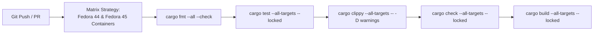

# Packaging & Continuous Integration

This guide documents the RPM packaging specification, CI validation pipelines, and automated nightly release workflows for RustyUKI.

---

## RPM Specification

The RPM spec file is located at [`.github/rpm/rustyuki.spec`](../.github/rpm/rustyuki.spec).

```spec
Name:           rustyuki
Version:        0.2.0
Release:        1%{?dist}
Summary:        Rust CLI to generate and install Fedora Unified Kernel Images

License:        MIT
URL:            https://github.com/GlitchSlayed/RustyUKI
Source0:        %{name}-%{version}.tar.gz

BuildRequires:  cargo
BuildRequires:  rust

%description
RustyUKI is a Rust-native CLI for building and installing Unified Kernel Images
on Fedora-based systems via dracut and ukify.

%prep
%autosetup -n %{name}-%{version}

%build
cargo build --release --locked

%install
install -Dpm0755 target/release/rustyuki %{buildroot}%{_bindir}/rustyuki

%files
%license LICENSE
%doc README.md
%{_bindir}/rustyuki

%changelog
* Fri Mar 13 2026 RustyUKI CI <ci@example.com> - 0.2.0-1
- Initial Fedora RPM spec for automated CI builds
```

### Local RPM Build

To build an RPM locally on a Fedora workstation:

```bash
# 1. Install packaging tools
sudo dnf install -y git rpm-build rpmdevtools cargo rust

# 2. Set up the RPM build tree
rpmdev-setuptree

# 3. Create the source archive
VERSION="0.2.0"
git archive --format=tar.gz --prefix="rustyuki-${VERSION}/" -o ~/rpmbuild/SOURCES/rustyuki-${VERSION}.tar.gz HEAD

# 4. Copy and build the spec
cp .github/rpm/rustyuki.spec ~/rpmbuild/SPECS/
rpmbuild -ba ~/rpmbuild/SPECS/rustyuki.spec

# 5. Resulting packages
ls -l ~/rpmbuild/RPMS/*/*.rpm
ls -l ~/rpmbuild/SRPMS/*.rpm
```

---

## Continuous Integration (`checks.yml`)

The repository runs continuous validation across a matrix of the latest two Fedora releases (**Fedora 44** and **Fedora 45**) on every push and pull request via [`.github/workflows/checks.yml`](../.github/workflows/checks.yml):



### Features Verified:
- **Matrix Testing**: Validates code and dependencies against Fedora 44 (`fedora:44`) and Fedora 45 (`fedora:45`).
- **Rustfmt Compliance**: Ensures consistent formatting across all modules and tests.
- **Unit and Integration Tests**: Runs tests in [`tests/integration_cli.rs`](../tests/integration_cli.rs) using mocked system calls (`MockRunner`).
- **Strict Clippy**: Enforces `-D warnings` across all code.
- **Lockfile Integrity**: Enforces `--locked` flags when `Cargo.lock` is present.

---

## Automated Nightly RPM Releases (`rpm.yml`)

The workflow in [`.github/workflows/rpm.yml`](../.github/workflows/rpm.yml) handles dual-target automated packaging:

### 1. `rpm-ci` (On Pull Requests and Pushes)
- Spins up containers across a matrix for both `fedora:44` and `fedora:45`.
- Packages the source tarball and builds binary and source RPMs (`.fc44` and `.fc45`).
- Uploads the resulting RPMs as separate workflow artifacts for testing without creating releases.

### 2. `plan-release`, `build-release-rpms`, and `publish-release` (Scheduled / Manual Dispatch)
- Runs daily at `03:17 UTC` and on `workflow_dispatch`.
- Inspects the latest `rpm-nightly-*` release tag against `HEAD`.
- If new commits were added (or if forced via manual dispatch):
  1. Concurrently builds clean binary and source RPMs on both **Fedora 44** and **Fedora 45** containers.
  2. Aggregates all RPM packages (`.fc44.x86_64.rpm`, `.fc44.src.rpm`, `.fc45.x86_64.rpm`, `.fc45.src.rpm`).
  3. Creates a single consolidated GitHub Release tagged `rpm-nightly-YYYYMMDD`.
  4. Publishes all built `.rpm` and `.src.rpm` files as release assets.
