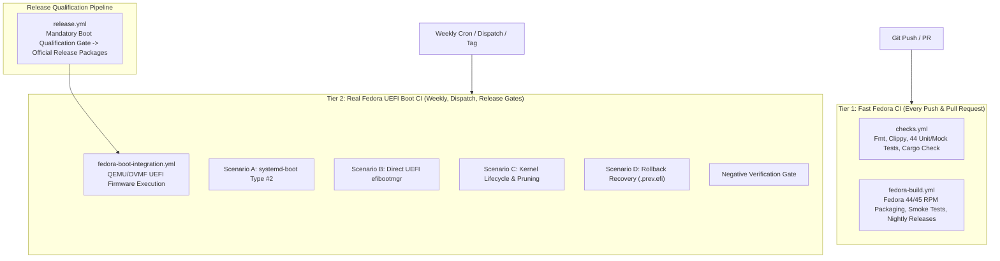

# Packaging & Continuous Integration

This guide documents the RPM packaging specification, CI validation pipelines, and automated nightly release workflows for RustyUKI targeting **Fedora 44** and **Fedora 45**.

---

## RPM Specification

The RPM spec file is located at [`.github/rpm/rustyuki.spec`](../.github/rpm/rustyuki.spec):

```spec
Name:           rustyuki
Version:        0.2.0
Release:        1%{?dist}
Summary:        Reliable, distribution-independent Unified Kernel Image lifecycle manager

License:        MIT
URL:            https://github.com/GlitchSlayed/RustyUKI
Source0:        %{name}-%{version}.tar.gz

BuildRequires:  cargo
BuildRequires:  rust
BuildRequires:  systemd-rpm-macros

Requires:       dracut
Requires:       systemd-ukify
Requires:       efibootmgr
Requires:       systemd-boot
Requires:       systemd-udev
Requires:       binutils

Recommends:     sbsign
Recommends:     pesign

%{?systemd_requires}

%description
RustyUKI is a failure-resistant Unified Kernel Image (UKI) manager for Linux systems.
It provides distinct generation, installation, and activation stages, supporting both
Direct UEFI and systemd-boot backends, multi-stage health assessment, safe fallback slots,
CachyOS and Fedora kernel compatibility, and offline sysroot generation.

%prep
%autosetup -n %{name}-%{version}

%build
cargo build --release --locked

%install
# Binary
install -Dpm0755 target/release/rustyuki %{buildroot}%{_bindir}/rustyuki

# Configuration
install -Dpm0644 packaging/config.toml %{buildroot}%{_sysconfdir}/rustyuki/config.toml

# kernel-install hook
install -Dpm0755 packaging/90-rustyuki.install %{buildroot}%{_prefix}/lib/kernel/install.d/90-rustyuki.install

# Systemd boot confirmation unit
install -Dpm0644 packaging/rustyuki-boot-confirm.service %{buildroot}%{_unitdir}/rustyuki-boot-confirm.service

# State directory for failure tracking and cmdline hash cache
install -d -m 0755 %{buildroot}%{_sharedstatedir}/uki-build

%post
%systemd_post rustyuki-boot-confirm.service

%preun
%systemd_preun rustyuki-boot-confirm.service

%postun
%systemd_postun_with_restart rustyuki-boot-confirm.service

%files
%license LICENSE
%doc README.md
%{_bindir}/rustyuki
%dir %{_sysconfdir}/rustyuki
%config(noreplace) %{_sysconfdir}/rustyuki/config.toml
%{_prefix}/lib/kernel/install.d/90-rustyuki.install
%{_unitdir}/rustyuki-boot-confirm.service
%dir %{_sharedstatedir}/uki-build
```

### Local RPM Build

To build an RPM locally on a Fedora workstation:

```bash
# 1. Install packaging tools
sudo dnf install -y git rpm-build rpmdevtools cargo rust systemd-rpm-macros

# 2. Set up the RPM build tree
rpmdev-setuptree

# 3. Create the source archive
VERSION="0.2.0"
git archive --format=tar.gz --prefix="rustyuki-${VERSION}/" -o ~/rpmbuild/SOURCES/rustyuki-${VERSION}.tar.gz HEAD

# 4. Copy and build the spec
cp .github/rpm/rustyuki.spec ~/rpmbuild/SPECS/
rpmbuild -ba ~/rpmbuild/SPECS/rustyuki.spec

# 5. Resulting packages
ls -l ~/rpmbuild/RPMS/*/*.rpm
ls -l ~/rpmbuild/SRPMS/*.rpm
```

---

# Two-Tier CI/CD Architecture & Packaging

RustyUKI implements a two-tier continuous integration and deployment architecture designed to balance rapid developer feedback on every commit with exhaustive, real-system boot validation for scheduled qualification and release gates:



---

## Tier 1: Fast Fedora CI

### 1. Code Quality & Unit Tests (`checks.yml`)
The workflow in [`.github/workflows/checks.yml`](../.github/workflows/checks.yml) runs across **Fedora 44** and **Fedora 45** containers on every push and PR:
- **Cargo Format Check**: `cargo fmt --all -- --check`
- **Strict Clippy**: `cargo clippy --all-targets --all-features -- -D warnings`
- **Unit and Integration Tests**: 44 tests across `tests/integration_cli.rs` and `tests/backend_and_safety.rs` using mocked system calls (`MockRunner`).
- **Cargo Caching**: Persistent caching of `~/.cargo/registry` and `target/` via `actions/cache@v4`.

### 2. Automated RPM Builds & Smoke Tests (`fedora-build.yml`)
The workflow in [`.github/workflows/fedora-build.yml`](../.github/workflows/fedora-build.yml) validates RPM packaging:
- **Clean Container Packaging**: Builds binary and source RPMs using Fedora RPM macros.
- **Installation Smoke Test**: Verifies binary execution, kernel-install plugin (`90-rustyuki.install`), config file (`config.toml`), and boot confirmation unit (`rustyuki-boot-confirm.service`).
- **Nightly Releases**: On pushes to `main`, packages and publishes an automated release tagged `rpm-nightly-YYYYMMDD-<short-sha>` with all `.rpm` and `.src.rpm` artifacts attached.

---

## Tier 2: Real Fedora UEFI Boot CI (`fedora-boot-integration.yml`)

The workflow in [`.github/workflows/fedora-boot-integration.yml`](../.github/workflows/fedora-boot-integration.yml) executes genuine QEMU/OVMF UEFI virtual machine tests against official Fedora installations:
- **Triggers**: Weekly schedule (`cron: '0 3 * * 0'`), manual `workflow_dispatch` (with release, backend, and scenario selectors), and `workflow_call` during release qualification.
- **Hardware Virtualization**: Runs on `ubuntu-24.04` runners using KVM (`/dev/kvm`), with automated fallback to TCG emulation when KVM is unavailable.
- **Dedicated 1GB ESP**: Provisions an isolated 1024MB FAT32 ESP drive attached to QEMU as `/dev/vdb` (mounted at `/efi`), ensuring multiple UKIs, backups, and kernel updates never face space constraints.
- **Persistent Image Caching**: Caches verified Fedora base images in `tests/vm/cache/` using SHA-256 digests pinned in [`scripts/fedora_image_manifest.json`](../scripts/fedora_image_manifest.json).
- **Disposable Overlays**: Tests never mutate the base image; every run uses a fresh qcow2 overlay and disposable `OVMF_VARS.fd`.

### Scenarios Covered
| Scenario | Backend | Description |
|---|---|---|
| **Scenario A** | `systemd-boot` | Fresh conversion from conventional Fedora GRUB to systemd-boot Type #2 UKI, firmware reboot, kernel assertion, and health verification (Mandatory release gate). |
| **Scenario B** | `direct` | Registration and boot through Direct UEFI firmware entry via `efibootmgr`, trial boot assessment, and boot confirmation (`rustyuki confirm`). |
| **Scenario C** | Lifecycle | Multiple kernel versions, automated UKI generation, reconciliation, and safe pruning retaining active and fallback slots. |
| **Scenario D** | Recovery | Rollback recovery preserving `.prev.efi` fallback slot intact for repeatable recovery operations. |
| **Negative Verification** | Safety Gate | Deliberately simulates guest assertion failures to verify the harness detects errors and never emits false passes. |

---

## Release Qualification Gate (`release.yml`)

The workflow in [`.github/workflows/release.yml`](../.github/workflows/release.yml) ensures that no release is published without passing real UEFI boot qualification:
1. Triggers on tag pushes (`v*`) or manual release dispatch.
2. Invokes `fedora-boot-integration.yml` on the exact release commit.
3. Only upon successful execution of all UEFI boot scenarios does it build the official Fedora 44 & 45 RPM packages and publish the GitHub Release.
